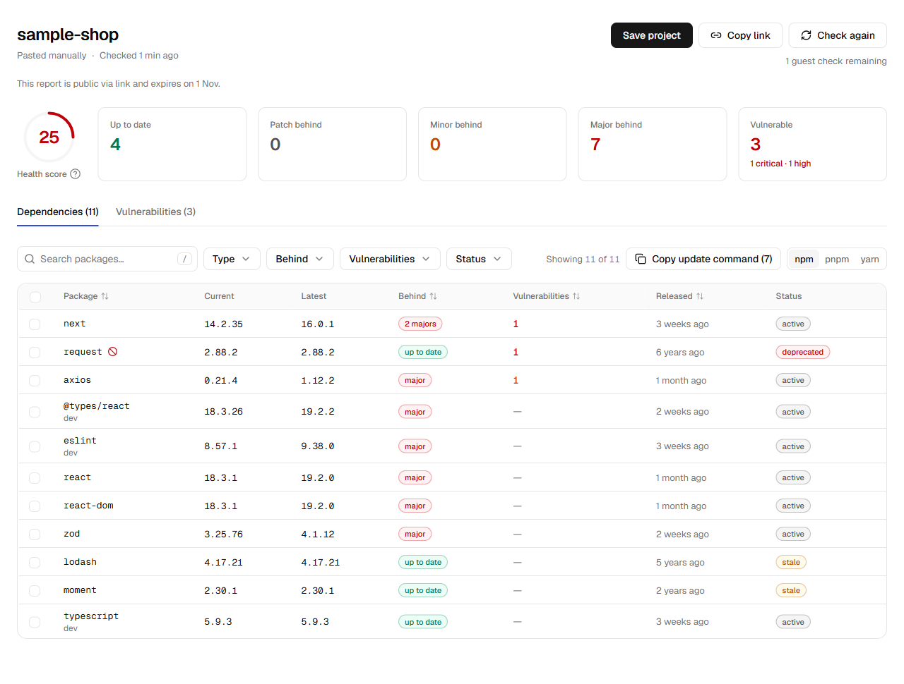

# Dependency Radar

Веб-сервис для проверки npm-зависимостей JS/TS-проектов: устаревшие версии, известные уязвимости и команды обновления.

<picture>
  <source media="(prefers-color-scheme: dark)" srcset="public/images/report-dark.png">
  
</picture>

Скриншот настоящего интерфейса с примером `sample-shop` и фиксированными ответами MSW. Это иллюстрация возможностей, а не актуальная проверка безопасности этих пакетов.

## Возможности MVP

- Проверка вставленного `package.json`, загруженных файлов или публичного GitHub-репозитория.
- Версии, отставание, deprecated/stale-статусы, оценка здоровья и уязвимости OSV с версиями исправлений.
- Прогресс по SSE, отмена, продолжение и повтор неудачных запросов; недоступность одного пакета не прерывает весь отчёт.
- Поиск, фильтры и сортировка в URL, публичная ссылка, карточка пакета и ленивые release notes с признаками breaking changes.
- Команды npm/pnpm/yarn для выбранных или отфильтрованных зависимостей.
- GitHub OAuth и вход по email-ссылке; сохранение отчёта в проект, дашборд и настройки.
- Светлая/тёмная тема, мобильные карточки, клавиатурная навигация и поддержка reduced motion.

Отдельный план обновления, экран истории, уведомления и командный доступ относятся к следующим версиям. `/demo` закрыт.

## Локальный запуск

Используйте Node.js 24 (как в CI), pnpm версии из `package.json` и PostgreSQL. Зависимости устанавливаются из lock-файла:

```sh
pnpm install --frozen-lockfile
```

Передайте переменные ниже через окружение процесса. Для локальной разработки Next.js также поддерживает `.env.local`; файл не должен попадать в Git. Имена перечислены в `.env.example`, значения задаются отдельно.

| Переменная                                 | Назначение                                                    |
| ------------------------------------------ | ------------------------------------------------------------- |
| `DATABASE_URL`                             | PostgreSQL для приложения и Drizzle                           |
| `BETTER_AUTH_SECRET`                       | Секрет подписи сессий Better Auth                             |
| `BETTER_AUTH_URL`                          | Адрес приложения; обязателен для production-входа             |
| `GITHUB_CLIENT_ID`, `GITHUB_CLIENT_SECRET` | OAuth-приложение GitHub; callback `/api/auth/callback/github` |
| `GITHUB_TOKEN`                             | Серверный доступ к GitHub API: репозитории и release notes    |
| `RESEND_API_KEY`, `EMAIL_FROM`             | Доставка magic link через Resend                              |
| `CRON_SECRET`                              | Авторизация ежедневной очистки `/api/cron/daily`              |
| `TEST_DATABASE_URL`                        | Явно выбранная одноразовая БД для интеграции и e2e            |
| `MOCK_EXTERNAL`                            | `1` включает MSW вместо npm, OSV и GitHub                     |
| `MOCK_EXTERNAL_DELAY_MS`                   | Задержка ответов MSW для проверки прогресса                   |

После выбора БД и согласования применения миграций:

```sh
pnpm db:migrate
pnpm dev
```

Откройте [localhost:3000](http://localhost:3000). В development без Resend email-ссылка выводится в серверный лог вместо отправки. В production без настроенного Resend форма email-входа скрыта. Для GitHub-входа нужны OAuth-настройки.

Production-сборка: `pnpm build`, затем `pnpm start`. На хостинге задайте те же переменные окружения. Ежедневную очистку вызывает GitHub Actions; она удаляет истёкшие гостевые отчёты и кэш, не запускает автоматическое обновление всех проектов.

## Проверки

| Команда                 | Проверка                                                              |
| ----------------------- | --------------------------------------------------------------------- |
| `pnpm lint`             | ESLint                                                                |
| `pnpm typecheck`        | TypeScript                                                            |
| `pnpm test`             | Unit и React Testing Library                                          |
| `pnpm build`            | Production build                                                      |
| `pnpm test:integration` | PostgreSQL-транзакции; setup применяет миграции к `TEST_DATABASE_URL` |
| `pnpm test:e2e`         | Playwright / Chromium                                                 |

Для e2e нужны установленный Chromium Playwright, мигрированная одноразовая БД, одинаковые `DATABASE_URL` и `TEST_DATABASE_URL`, `MOCK_EXTERNAL=1`, а также одинаковые тестовые `BETTER_AUTH_SECRET` и `CRON_SECRET` у сервера и тестов. Конфигурация запускает dev-сервер автоматически или использует уже работающий на порту 3000: убедитесь, что это именно тестовый стенд. В CI окружение описано в [workflow](.github/workflows/ci.yml).

Не направляйте интеграцию/e2e на рабочую БД: тесты создают данные и проверяют очистку. `pnpm db:seed` оставлен для исторического демо и для обычного запуска не нужен.

Результаты приёмки и невыполненные проверки — в [этапе F плана](docs/plan.md). Прохождение MSW-тестов не подтверждает скорость или доступность реальных внешних API.

## Ограничения

- Три новых гостевых запуска на браузер без восстановления; отмена и ошибки после запуска не возвращают попытку. Resume/Retry продолжают прежнюю проверку без расхода этой квоты.
- Дополнительно: 10 проверок/час на IP гостя, 30/час для аккаунта; 60 секунд между новыми проверками одного отчёта или проекта.
- Гостевой отчёт доступен по ссылке семь дней. Сохранённые проекты доступны владельцу.
- Не более 300 прямых зависимостей; `package.json` — до 1 MB. В MVP разбирается только `package-lock.json` v2/v3. Без lock-файла текущая версия — максимальная, подходящая под диапазон, а не гарантированно установленная локально.
- Источники кэшируются в PostgreSQL на час. Release notes загружаются при открытии карточки. Признаки breaking changes определяются эвристически.

## Стек и устройство

Next.js App Router, React, TypeScript strict, Tailwind CSS v4, Radix UI, Geist, Lucide; PostgreSQL/Neon и Drizzle; Better Auth и Resend; Zod, React Hook Form, TanStack Table/Virtual, nuqs, semver; Vitest, Testing Library, MSW и Playwright.

`src/app` — маршруты; `src/features` — сценарии; `src/components/ui` — примитивы; `src/server/sources` — внешние API; `src/server/analysis` — чистая логика; `src/server/db` — данные.

- [Спецификация и критерии приёмки](docs/spec.md)
- [Экраны и состояния](docs/screens.md)
- [Архитектура](docs/architecture.md) и [решения](docs/decisions.md)
- [План](docs/plan.md), [рабочий процесс](docs/workflow.md), [стиль](docs/design/style-guide.md)
