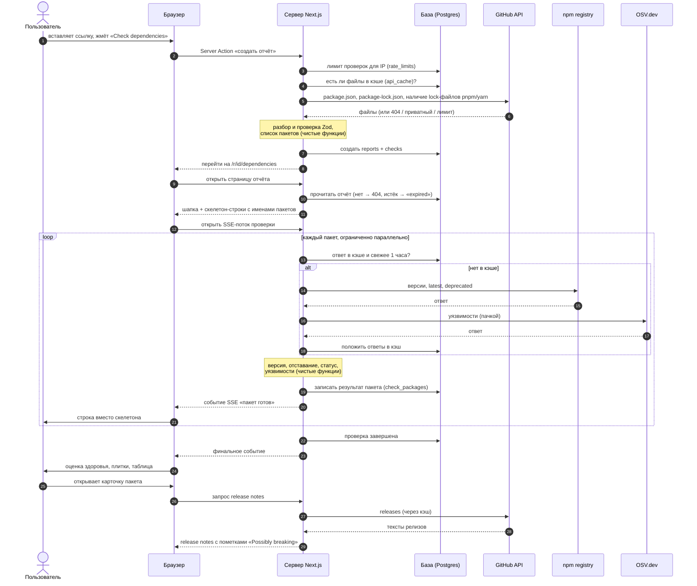

# Dependency Radar — как устроен продукт (простыми словами)

Документ для автора: как работает проверка от клика до таблицы, где что лежит в коде и зачем задачи плана идут в таком порядке. Правила поведения — в `spec.md` и `screens.md`, решения по стеку — в `decisions.md`, задачи — в `plan.md`. Если этот документ с ними расходится, правы они.

Кода пока нет (папки `src/` ещё не существует), поэтому здесь описан задуманный вариант. Места, которые ещё не решены, помечены **«не решено»** со ссылкой на задачу плана.

---

## 0. Словарик

Слова, которые встречаются ниже. Каждое объяснено один раз.

| Слово | Что это значит |
|---|---|
| **Браузер / клиент** | Программа у пользователя, которая показывает страницы и выполняет JavaScript. |
| **Сервер** | Наш код, который работает не у пользователя, а на машине Vercel. Только он ходит во внешние сервисы и в базу. |
| **Next.js** | Фреймворк, в котором в одном проекте живут и страницы, и серверный код. |
| **Маршрут (route)** | Адрес страницы, например `/r/abc123/dependencies`. В Next.js маршрут = папка в `src/app`. |
| **Server Component** | Кусок страницы, который собирается на сервере: он может сам прочитать базу, а в браузер уходит готовый HTML. Кнопки в нём не «оживают». |
| **Client Component** | Кусок страницы, который работает в браузере: реагирует на клики, ввод, держит состояние. Помечается `"use client"`. |
| **Server Action** | Серверная функция, которую браузер вызывает как обычную функцию (например, при отправке формы). Используется для действий, которые что-то меняют: создать отчёт, сохранить проект. |
| **Route handler** | Обычный HTTP-адрес на нашем сервере (папка `src/app/api/...`), который возвращает не страницу, а данные. Нужен для потока прогресса, ежедневной задачи. |
| **SSE (Server-Sent Events)** | Способ держать одно HTTP-соединение открытым, чтобы сервер мог присылать браузеру сообщения по одному, как только они готовы: «пакет react проверен», «пакет lodash проверен»… Поток идёт только от сервера к браузеру. |
| **База данных (БД)** | PostgreSQL на сервисе Neon. Таблицы, где хранятся отчёты, проверки, пользователи, кэш. |
| **ORM (Drizzle)** | Библиотека, через которую код пишет и читает таблицы на TypeScript, а не голым SQL. |
| **Миграция** | Файл с изменением структуры базы (создать таблицу, добавить колонку). Применяется командой `pnpm db:migrate`. |
| **Внешний API** | Чужой сервис, у которого мы спрашиваем данные: npm registry, OSV.dev, GitHub. |
| **npm registry** | Каталог всех npm-пакетов: какие версии есть, когда вышли, какая последняя, помечен ли пакет устаревшим. |
| **OSV.dev** | Открытая база уязвимостей. Спрашиваем: «есть ли дыры в `lodash@4.17.15`?» |
| **GitHub API** | Через него читаем файлы из публичного репозитория и release notes (описания релизов). |
| **Кэш** | Сохранённый ответ внешнего API. Если тот же вопрос задают снова в течение часа, берём ответ из базы, а не идём в интернет. |
| **TTL** | Срок жизни записи в кэше (у нас 1 час). |
| **Zod** | Библиотека проверки данных: описываем, какой формы должны быть данные, и она говорит «подходит» или «вот что не так». Применяем ко всему, что приходит снаружи. |
| **Чистая функция** | Функция, которая только считает: на вход данные, на выход результат. Не ходит в сеть и в базу. Её легко тестировать. |
| **Ограничение параллельности** | Делаем, например, не больше 8 запросов одновременно, а не 300 сразу, чтобы внешние сервисы нас не заблокировали. |
| **Rate limit** | Лимит запросов. Есть у GitHub (сколько запросов в час можно нам) и у нас самих (сколько проверок в час можно гостю). Ответ сервиса «слишком часто» — код **429**. |
| **lock-файл** | `package-lock.json`: точные версии, которые реально установлены. В `package.json` часто записан диапазон (`^18.2.0`), а в lock-файле — конкретная `18.3.1`. |
| **Диапазон версий / semver** | Запись вида `^18.2.0` — «любая 18.x.x не ниже 18.2.0». Библиотека `semver` умеет такие записи разбирать и сравнивать версии. |
| **Отставание** | Насколько текущая версия старее последней: патч (`1.2.3 → 1.2.5`), минорное (`1.2 → 1.4`), мажорное (`1 → 3`). |
| **URL search params** | Часть адреса после `?`, например `?vuln=yes&sort=behind`. В них храним фильтры, чтобы ссылка открывала ту же выборку. Библиотека nuqs. |
| **Скелетон** | Серая «заглушка» на месте ещё не загруженных данных. |

---

## 1. Что происходит, когда пользователь вставляет ссылку на репозиторий

Пример: гость открывает главную, выбирает вкладку «GitHub URL», вставляет `https://github.com/acme/shop` и жмёт «Check dependencies».

### Шаг 1. Браузер: отправка формы
- Кнопка становится неактивной и показывает «Starting…».
- Форма вызывает **Server Action** «создать гостевой отчёт» и передаёт ему ссылку. Дальше всё происходит на сервере.

### Шаг 2. Сервер: проверка ввода и лимита
- Zod проверяет, что это действительно ссылка вида `https://github.com/владелец/репозиторий`. Нет — в браузер возвращается ошибка, она показывается под полем, перехода не будет.
- Проверяется **наш** лимит: гость может запустить не больше 10 проверок в час с одного IP. Счётчики лежат в таблице `rate_limits`. Превышен — «Too many checks. Try again in N minutes.»

### Шаг 3. Сервер → GitHub: забираем файлы
- Через клиент GitHub (`src/server/sources/github`) сервер просит у GitHub `package.json` из корня репозитория и, если есть, `package-lock.json`. Запрос идёт с нашим `GITHUB_TOKEN`, иначе лимит GitHub — всего 60 запросов в час.
- Заодно смотрим, есть ли в репозитории `pnpm-lock.yaml` или `yarn.lock` (не читаем их, только факт наличия) — по этому потом выберем, какую команду обновления предложить: npm, pnpm или yarn.
- Возможные ошибки: репозиторий не найден или приватный, в корне нет `package.json`, GitHub ограничил нас по лимиту. Каждая превращается в понятное сообщение под полем.

### Шаг 4. Сервер: разбор файла (чистые функции)
- `package.json` разбирается и проверяется Zod-схемой. Ошибки: не JSON, нет зависимостей, больше 300 зависимостей, больше 1 MB, это вообще lock-файл. Если есть `workspaces` (монорепозиторий) — не ошибка, а предупреждение «проверяем только корень».
- Из него получается список пакетов: имя, указанный диапазон, тип (обычная или dev-зависимость).
- Каждый спецификатор классифицируется: обычная версия из npm, тег (`latest`), алиас (`npm:other-name@1.0`), или «не из npm» (`git+…`, `file:…`, `workspace:…`). Последние сразу получат статус «Not checked — Not from npm registry», в сеть за ними не ходим.
- Если есть `package-lock.json`, из него берутся точные установленные версии.

### Шаг 5. Сервер → БД: создаём отчёт
- В базу пишется **отчёт** (`reports`): откуда взяли данные, имя проекта, список пакетов, срок жизни «через 7 дней» (`expiresAt`).
- Создаётся запись о **проверке** (`checks`) — пока «в процессе».
- Server Action отвечает браузеру: «перейди на `/r/<id>/dependencies`».

### Шаг 6. Браузер: открывается страница отчёта
- Страница отчёта — **Server Component**. Сервер читает отчёт из базы:
  - нет такого отчёта → страница 404;
  - срок истёк → «This report has expired.» (срок проверяется при каждом открытии, а не только ежедневной чисткой);
  - иначе отдаёт шапку отчёта и таблицу, где у каждого пакета уже есть имя, но вместо данных — скелетон.
- Внутри страницы есть **Client Component** с хуком, который сразу открывает **SSE-соединение** к route handler проверки.

### Шаг 7. Сервер: проверка пакетов (оркестратор)
Route handler запускает «оркестратор» — код, который раздаёт работу и собирает результаты. Для каждого ещё не проверенного пакета:
1. **npm registry**: список версий, тег `latest`, даты выхода, флаг «deprecated», ссылка на репозиторий. Сначала ищем ответ в кэше (`api_cache`); если он свежее часа — берём его, иначе идём в интернет и кладём ответ в кэш.
2. **OSV.dev**: уязвимости для текущей версии. Запрашиваются пачкой (`querybatch`) сразу на много пакетов, а не по одному.
3. Все ответы проверяются Zod. Странный ответ = ошибка этого пакета, а не всего отчёта.
4. **Чистые функции** из `src/server/analysis` считают: текущую версию (из lock-файла или максимальную, подходящую под диапазон), последнюю стабильную, отставание, статус (active / stale / deprecated / not checked), объединённый список уязвимостей (GHSA и CVE об одной проблеме — одна уязвимость).
5. Результат пакета **сразу** пишется в базу (`check_packages`) и **сразу** отправляется в браузер событием SSE.

Запросы идут с ограниченной параллельностью. Если внешний сервис ответил «слишком часто» (429) или упал (5xx), этот пакет помечается «Not checked» с причиной, а остальные проверяются дальше.

Release notes с GitHub при проверке **не** загружаются: только npm и OSV. Они подгружаются позже, когда пользователь откроет карточку пакета.

### Шаг 8. Браузер: таблица наполняется
- Каждое событие SSE заменяет скелетон-строку на настоящую строку. В шапке растёт «Checking dependencies… 34 of 112».
- Когда все пакеты готовы, приходит финальное событие: полоса прогресса исчезает, появляются оценка здоровья (0–100) и пять плиток-счётчиков. Их считают те же чистые функции по сохранённым результатам.
- Если часть пакетов не проверилась — жёлтая плашка «12 packages couldn't be checked» с кнопками «Show» и «Retry failed».

### Шаг 9. Дальше пользователь работает с таблицей
- Сортировка, поиск и фильтры работают в браузере, без новых запросов, но записываются в адрес (`?q=react&vuln=yes`), поэтому «Copy link» передаёт ту же выборку.
- Клик по строке открывает карточку пакета (`?pkg=react`). Тогда сервер лениво идёт в GitHub за release notes (тоже через кэш).

### Что если закрыть вкладку посреди проверки
Соединение SSE обрывается, проверка останавливается. Всё, что успели, уже лежит в базе. При следующем открытии «Resume» проверит только оставшиеся пакеты.

**Не решено (задача 2):** у функций на Vercel есть лимит длительности. Если проверка 300 пакетов в него не укладывается, схема меняется: проверку запускает отдельный запрос и пишет прогресс в базу, а SSE-соединение только читает этот прогресс из базы и пересылает в браузер. Для пользователя всё выглядит так же.

**Не решено (задачи 7 и 10):** точный адрес SSE route handler и где хранится итоговая оценка (сохраняется в `checks` или пересчитывается при каждом открытии).

---

## 2. Схема потока

---

## 3. За что отвечает каждая папка `src/`

| Папка | За что отвечает | Пример содержимого |
|---|---|---|
| `src/app/` | **Маршруты.** Каждая папка — адрес в браузере. Здесь только «склейка»: какой экран показать, какие данные для него прочитать. | `page.tsx` лендинга, `r/[reportId]/dependencies/page.tsx`, `projects/...`, `login/...` |
| `src/app/api/` | **Route handlers** — адреса, которые отдают данные, а не страницы. | поток SSE проверки, `/api/cron/daily` для ежедневной чистки |
| `src/components/ui/` | **Кирпичики интерфейса** без знания о продукте: кнопка, бейдж, поле ввода, диалог, тост, скелетон. Не знают, что такое «пакет» или «уязвимость». | `button.tsx`, `badge.tsx`, `dialog.tsx` |
| `src/components/` | **Общие компоненты продукта**, которые нужны в нескольких местах. | шапка сайта, подвал, плашка демо |
| `src/features/<фича>/` | **Всё для одной фичи в одном месте:** её компоненты, хуки, Server Actions, тексты интерфейса. | `features/report/` (таблица, сводка, карточка пакета, SSE-хук), `features/check-form/`, `features/projects/` |
| `src/server/db/` | **База:** описание таблиц (схема Drizzle), подключение, готовые запросы «прочитать отчёт», «записать результат пакета». | `schema.ts`, `client.ts`, `queries/*.ts` |
| `src/server/sources/` | **Клиенты внешних сервисов:** npm, OSV, GitHub. Единственное место, откуда код ходит в интернет. Здесь же кэш в базе, ограничение параллельности, обработка 429/5xx и Zod-проверка ответов. | `npm.ts`, `osv.ts`, `github.ts`, `cache.ts` |
| `src/server/analysis/` | **Мозг продукта — чистые функции.** Разбор `package.json` и lock-файла, расчёт версий и отставания, статусы, объединение уязвимостей, оценка здоровья, счётчики, поиск признаков breaking changes, генерация команды `npm i` / `pnpm add` / `yarn add`. Без сети и базы, всё покрыто unit-тестами. | `parse-input.ts`, `versions.ts`, `health-score.ts`, `vulnerabilities.ts` |
| `src/lib/` | **Мелкие общие утилиты**, не привязанные к фиче. | форматирование дат, работа с классами CSS |
| `tests/e2e/` (вне `src`) | Сценарии Playwright: настоящий браузер проходит путь пользователя. Внешние API подменяются MSW. | «вставил package.json → увидел отчёт» |

Правило направления: `app` и `features` вызывают `server`; `server/analysis` никого не вызывает (только считает); в интернет ходит только `server/sources`.

---

## 4. Что хранится в базе и зачем

| Таблица | Что в ней | Зачем |
|---|---|---|
| `reports` | Отчёт: источник (вставлен / загружен / ссылка на репо), имя, исходный список пакетов и lock-данные, выбранный по умолчанию менеджер пакетов. У гостевого — срок `expiresAt` (7 дней), у сохранённого — ссылка на проект. | Чтобы ссылку на отчёт можно было открыть в другом браузере и чтобы проверку можно было повторить без повторной загрузки файла. |
| `checks` | Одна проверка отчёта: когда началась, статус (идёт / завершена / частично / отменена / провал). | Отчёт можно проверять много раз («Check again»). Хранение всех проверок — задел под историю в версии 1.1. |
| `check_packages` | Результат по каждому пакету в проверке: текущая и последняя версия, отставание, статус, уязвимости, причина, если не проверен. | Результат пишется сразу, как готов. Поэтому обрыв соединения не теряет работу, а «Resume» / «Retry failed» доделывают только недостающее. |
| `projects` | Сохранённые проекты пользователя: имя, источник, владелец. | Дашборд `/projects` и отчёт `/projects/[id]`. Гостевой отчёт превращается в проект кнопкой «Save project». |
| `api_cache` | Ответы npm, OSV, GitHub: ключ запроса, ответ, время, когда протухнет (1 час). | Повторная проверка в течение часа почти мгновенна, и мы не упираемся в лимиты GitHub. Отдельный сервис (Redis) не нужен. |
| `rate_limits` | Счётчики проверок: кто (IP гостя или пользователь), сколько, в каком окне времени. | Защита от злоупотреблений: гость 10 проверок в час, вошедший 30. Хранится в базе, потому что на Vercel нет постоянной памяти между запросами. |
| Таблицы Better Auth | Пользователи, сессии входа, привязанные аккаунты GitHub, одноразовые токены для входа по ссылке из письма. Точные имена и поля задаёт сама библиотека. | Вход через GitHub и по email. Сессии хранятся у нас, без внешнего сервиса. |

**Что в базе не храним:** ключи и токены (они только в переменных окружения), исходные загруженные файлы дольше, чем живёт отчёт. Гостевые отчёты старше 7 дней ежедневная задача удаляет физически.

Точная структура таблиц появится в задаче 7 вместе с записью в `decisions.md`.

---

## 5. Блоки плана: что строим и почему в таком порядке

**A. Основа (задачи 1–3).** Пустой проект Next.js со всеми инструментами: строгий TypeScript, линтер, Tailwind с нашими цветами и шрифтами, тесты, CI в GitHub Actions, деплой на Vercel, базовые компоненты интерфейса (кнопки, бейджи, диалоги) и страница 404. Это идёт первым, потому что всё остальное на этом стоит: без CI ошибки накапливаются незаметно, без UI-кирпичиков каждый экран рисовался бы по-своему. Кроме того, в задаче 2 проверяется лимит длительности функции на Vercel, а от него зависит, как будет устроен движок проверки в блоке C, — это нужно знать до того, как его писать.

**B. Чистая логика (задачи 4–6).** Разбор `package.json` и lock-файла, расчёт версий, отставания и статусов, объединение уязвимостей, оценка здоровья, счётчики, поиск признаков breaking changes, команды обновления. Это самая важная и самая хитрая часть продукта: если оценка или «Fixed in» считаются неверно, никакой красивый интерфейс не спасёт. Она идёт рано, потому что не зависит ни от базы, ни от сети, её можно полностью покрыть тестами за несколько сессий, а все следующие блоки будут просто вызывать готовые проверенные функции. Тесты пишутся первыми: сначала описываем, какой ответ правильный, потом пишем код.

**C. Данные и источники (задачи 7–10).** Таблицы в базе, кэш, клиенты npm / OSV / GitHub и оркестратор проверки с потоком SSE. Порядок внутри блока снизу вверх: сначала где хранить (схема), потом откуда брать (клиенты с кэшем), потом кто всем управляет (оркестратор, который соединяет клиентов, чистую логику из блока B и базу). Блок идёт после B, потому что оркестратор только склеивает уже готовые части, и до интерфейса, потому что интерфейсу нужны настоящие данные. Внешние сервисы в тестах подменяются MSW, чтобы тесты не зависели от интернета.

**D. Гостевой сценарий (задачи 11–19).** Лендинг с формой, страница отчёта с прогрессом и сводкой, таблица с сортировкой, фильтрами в адресе, выделением и мобильным видом, вкладка уязвимостей, карточка пакета, переключатель npm/pnpm/yarn, release notes. Это главный путь продукта и то, что увидит человек из портфолио, поэтому он идёт сразу, как готов движок. Аккаунта здесь ещё нет — и он не нужен: гость проходит весь путь без входа. Таблица разбита на несколько задач (колонки → фильтры → выделение и виртуализация), потому что каждая часть сама по себе большая, а так после каждой сессии есть что посмотреть.

**E. Аккаунт и проекты (задачи 20–24).** Вход через GitHub и по ссылке на email, лимиты проверок, сохранение гостевого отчёта как проекта, дашборд проектов, создание проекта, настройки. Идёт после D, потому что сохранённый проект показывается теми же компонентами отчёта, которые уже построены, — блок E переиспользует, а не строит заново. Лимиты стоят здесь, потому что лимит вошедшего пользователя (30 в час) нельзя сделать без понятия «пользователь».

**F. Демо, фоновые задачи, приёмка (задачи 25–29).** Демо-аккаунт с заранее заполненными проектами, ежедневная задача (удалить старые гостевые отчёты, сбросить демо), сквозные состояния (офлайн, тосты, все сообщения об ошибках), проверка мобильной версии и доступности, финальные e2e-сценарии по критериям приёмки и README. Демо идёт в конце, потому что для него нужны и проекты, и вход. Сквозные проверки и приёмка — в самом конце, потому что проверяют весь продукт целиком, когда все экраны уже на месте.
