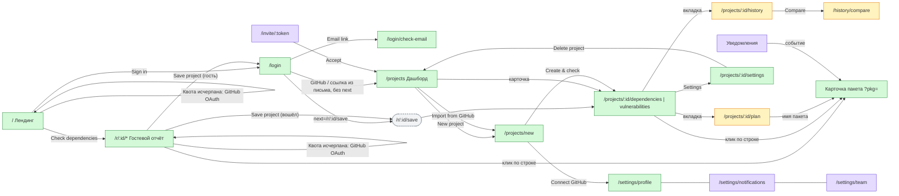

# Dependency Radar — экраны, маршруты и навигация (эталон)

Цвета на вайрфреймах не финальные, цвета — только из style-guide.

Версия 2.3 · 25.10.2026 · дополняет `docs/spec.md` v1.4.

> Гостевая квота и закрытие демо — целевое поведение ещё не выполненной задачи 26.2 ([решение 53](decisions.md#decision-53)).

Этот документ — единственный источник правды о том, **какие экраны есть, по каким адресам они открываются, что на них расположено, куда ведёт каждое действие и как экран выглядит в каждом состоянии**. Визуально то же самое показано в `sitemap.excalidraw` (навигация) и `wireframes.excalidraw` (раскладка экранов). Если картинка и этот текст расходятся, прав текст.

Тексты интерфейса даны на английском в «кавычках» — это точные формулировки для UI.

Этапы: **[MVP]**, **[1.1]**, **[1.2]** — по разделу 11 ТЗ. Делать только экраны и элементы текущего этапа.

---

## 1. Принципы навигации

1. **Каждое значимое состояние имеет адрес.** Вкладка, фильтры, сортировка, поиск и открытая карточка пакета хранятся в URL. Ссылку можно отправить коллеге, и он увидит то же самое. Кнопки «назад/вперёд» браузера работают предсказуемо.
2. **Отдельного экрана «прогресс проверки» нет.** Отчёт открывается сразу и заполняется по мере проверки.
3. **Карточка пакета — панель поверх отчёта, а не отдельная страница.** Открывается параметром `?pkg=<name>`, закрывается Esc, крестиком или кнопкой «назад» браузера. При прямом заходе по ссылке открывается отчёт с уже открытой панелью.
4. **Гость и пользователь видят один и тот же отчёт.** Отличаются только шапка и доступные действия.
5. **Никаких тупиков.** У каждого пустого, ошибочного и «не найдено» состояния есть действие, ведущее дальше.
6. **После входа пользователь возвращается туда, откуда пришёл** (параметр `next`). Без `next` попадает на `/projects`.

## 2. Карта маршрутов

| Адрес | Экран | Доступ | Этап |
|---|---|---|---|
| `/` | Лендинг + быстрая проверка | все (вошедший тоже видит лендинг, в шапке «Dashboard») | MVP |
| `/login?next=` | Вход | только гости (вошедшего перенаправляет на `next` или `/projects`) | MVP |
| `/login/check-email?email=` | «Проверьте почту» | гости | MVP |
| `/demo` | 404; прежний вход в демо закрыт | все | MVP, задача 26.2 |
| `/r/[reportId]` | Редирект на `/r/[reportId]/dependencies` | все, по ссылке | MVP |
| `/r/[reportId]/dependencies` | Гостевой отчёт, вкладка «Dependencies» | все | MVP |
| `/r/[reportId]/vulnerabilities` | Гостевой отчёт, вкладка «Vulnerabilities» | все | MVP |
| `/r/[reportId]/save` | Без интерфейса: сохраняет гостевой отчёт как проект и переходит в проект | вошедшие (гостя отправляет на `/login?next=…`) | MVP |
| `/projects` | Дашборд проектов | вошедшие | MVP (простой), 1.1 (полный) |
| `/projects/new` | Создание проекта | вошедшие | MVP |
| `/projects/[id]` | Редирект на `/projects/[id]/dependencies` | участники проекта | MVP |
| `/projects/[id]/dependencies` | Отчёт, вкладка «Dependencies» | участники | MVP |
| `/projects/[id]/vulnerabilities` | Отчёт, вкладка «Vulnerabilities» | участники | MVP |
| `/projects/[id]/plan` | Отчёт, вкладка «Upgrade plan» | участники | 1.1 |
| `/projects/[id]/history` | Отчёт, вкладка «History» | участники | 1.1 |
| `/projects/[id]/history/compare?from=&to=` | Сравнение двух проверок | участники | 1.1 |
| `/projects/[id]/settings` | Настройки проекта | MVP: владелец; 1.2: владелец команды | MVP |
| `/settings` | Редирект на `/settings/profile` | вошедшие | MVP |
| `/settings/profile` | Профиль, тема, удаление аккаунта | вошедшие | MVP |
| `/settings/notifications` | Настройки уведомлений | вошедшие | 1.2 |
| `/settings/team` | Команда: участники и приглашения | вошедшие | 1.2 |
| `/notifications` | Уведомления (полная страница для мобильных) | вошедшие | 1.2 |
| `/invite/[token]` | Принятие приглашения в команду | все (гостя ведёт через вход) | 1.2 |
| любой несуществующий | 404 | все | MVP |

Параметры отчёта (обе вкладки, гостевой и сохранённый): `q` (поиск), `type` (`prod`, `dev`), `lag` (`major`, `minor`, `patch`, `current`; можно несколько), `vuln` (`any`, `critical`, `high`, `moderate`, `low`), `status` (`active`, `stale`, `deprecated`, `unchecked`), `sort` (`name`, `lag`, `vulns`, `released`; префикс `-` означает убывание), `pkg` (открытая карточка пакета). Значения по умолчанию в URL не пишутся.

## 3. Граф переходов

## 4. Каркас приложения (общие элементы)

### 4.1. Шапка гостя (лендинг, вход, гостевой отчёт)
Слева логотип «Dependency Radar» → `/`. Справа «Sign in» → `/login`. При входе из гостевого отчёта или после исчерпания квоты передавать безопасный `next` с текущим путём и query. Ссылок на демо нет ни на desktop, ни в мобильном меню.

### 4.2. Шапка приложения (все страницы после входа)
- Слева логотип → `/projects`.
- Справа: **[1.2]** колокольчик со счётчиком непрочитанных (на desktop открывает панель уведомлений, на мобильных ведёт на `/notifications`); аватар с меню: «Settings» → `/settings/profile`, «Theme» (Light / Dark / System), «Sign out» → `/`.
- Других пунктов навигации нет: в продукте одна основная зона — проекты.

### 4.3. Остаток гостевой квоты (задача 26.2)
На лендинге рядом с кнопкой запуска и в шапке гостевого отчёта показывать серверный остаток: «3 guest checks remaining», «2 guest checks remaining», «1 guest check remaining». После успешного создания проверки обновлять остаток; сервер повторно проверяет его при каждом новом запуске, в том числе при устаревшем UI в другой вкладке.

При нуле: «You've used all 3 guest checks in this browser.» и «Continue with GitHub» вместо «Check dependencies» / «Check again». CTA начинает GitHub OAuth с возвратом на исходный локальный путь с query-параметрами; возврат не запускает проверку и не сохраняет отчёт. Ошибку/отмену OAuth обрабатывать как в 5.2, сохраняя адрес возврата. Для email остаётся обычный «Sign in» через `/login` с тем же `next`.

Просмотр результатов, «Save project», «Copy link», «Resume», «Retry failed» и «Try again» существующей проверки доступны при нуле; часовые ограничения по-прежнему могут запретить продолжение. Для ошибки часового лимита использовать отдельное сообщение из 5.1 с временем ожидания. После входа гостевой счётчик и CTA квоты скрываются: действует лимит аккаунта. После выхода отображается прежний гостевой остаток. Демо-плашки нет.

### 4.4. Тосты
Правый нижний угол (на мобильных — снизу по центру). Скрываются через 5 с, с действием «Undo» — через 8 с. Используются для подтверждений: «Project saved», «Link copied», «Package snoozed — Undo».

### 4.5. Баннер офлайна
Вверху: «You're offline. Showing last loaded data.» Действия, которым нужна сеть, недоступны и подписаны.

### 4.6. Подвал
Только на страницах гостя: ссылка на GitHub-репозиторий проекта, «Made by Pavel», ссылка на портфолио.

## 5. Экраны

Формат: назначение → раскладка сверху вниз → действия (что → куда) → состояния → крайние случаи.

---

### 5.1. Лендинг `/` [MVP]

**Назначение:** за 10 секунд объяснить, что делает продукт, и дать проверить свой проект без регистрации.

**Раскладка:**
1. Шапка гостя (4.1).
2. Hero: заголовок «Know what's outdated, vulnerable and breaking — before you upgrade.», подзаголовок «Paste your package.json and get an upgrade plan in seconds. No sign-up.»
3. Блок проверки (главный элемент страницы):
   - переключатель источника: «Paste» | «Upload file» | «GitHub URL»;
   - Paste: многострочное поле с плейсхолдером `{ "dependencies": { ... } }`;
   - Upload: зона перетаскивания «Drop package.json (and optionally package-lock.json) here or browse»;
   - GitHub URL: поле `https://github.com/owner/repo`, подсказка «Public repositories only»;
   - остаток гостевой квоты и кнопка «Check dependencies» (основная), при нуле — состояние из 4.3;
   - ссылка под кнопкой «or try a sample project» — заполняет поле примером бесплатно; его запуск расходует одну попытку, как любой другой источник.
4. Полоса доверия: «Data from npm registry, OSV.dev and GitHub».
5. «How it works»: три шага в ряд (на мобильных — столбиком): «Paste or upload» → «We check every package» → «Get your upgrade plan».
6. Пример отчёта: статичный скриншот без кнопки «Open live demo» и без перехода в демо.
7. Подвал (4.6).

**Действия:**
| Действие | Результат |
|---|---|
| «Check dependencies» с корректными данными и доступным лимитом | создаются гостевой отчёт и проверка, списывается одна гостевая попытка → `/r/[id]/dependencies`; для вошедшего действует лимит аккаунта |
| «Check dependencies» с ошибкой | ошибка под полем, перехода нет |
| «Continue with GitHub» при нулевой квоте | GitHub OAuth → исходная страница с query; автоматического запуска нет |
| «Sign in» | `/login` |

**Состояния:** во время отправки на кнопке спиннер и текст «Starting…», кнопка неактивна. Ошибки показываются под полем, поле подсвечено, фокус переходит на поле:
- «This doesn't look like valid JSON.» (+ номер строки, если удалось определить);
- «No dependencies found in this file.»;
- «Repository not found or private.»;
- «No package.json in the repository root.»;
- «GitHub is rate-limiting us. Try again in N minutes.»;
- «File is too large (max 1 MB).»;
- «Too many checks. Try again in N minutes.»;
- «Too many dependencies (max 300).»

**Крайние случаи:** вставлен lock-файл вместо `package.json` → «This is a lockfile. Paste package.json instead (you can add the lockfile in Upload).»; монорепозиторий с workspaces → проверяется только корневой `package.json` с предупреждением «Workspaces aren't supported yet — checking root package.json only.»

---

### 5.2. Вход `/login` [MVP]

**Раскладка:** по центру карточка шириной до 400px: заголовок «Sign in to Dependency Radar», кнопка «Continue with GitHub», разделитель «or», поле email + кнопка «Send sign-in link», мелкий текст «No passwords. We'll email you a magic link.». Только если `next` ведёт на `/r/[id]/save`, над формой: «Sign in to save your report.» Возврат на обычную страницу отчёта или лендинг не означает сохранение и не показывает этот текст. Email-вход сохраняется, в том числе после исчерпания гостевой квоты.

**Действия:** GitHub → OAuth → `next` или `/projects`. Email → `/login/check-email?email=…`.

**Состояния:** ошибка OAuth (отмена или сбой) — «GitHub sign-in was cancelled or failed. Try again.»; некорректный email — ошибка под полем; отправка — спиннер на кнопке.

### 5.3. «Проверьте почту» `/login/check-email` [MVP]
Иконка письма, «Check your inbox», «We sent a sign-in link to **email**. It expires in 15 minutes.», кнопка «Resend link» (неактивна 60 с, с обратным отсчётом), ссылка «Use a different email» → `/login`. Ссылка из письма → `next` или `/projects`. Просроченная ссылка → `/login` с сообщением «This link has expired. Request a new one.»

---

### 5.4. Отчёт [MVP]: гостевой `/r/[id]/*` и сохранённый `/projects/[id]/*`

Главный экран продукта. Одна страница, два режима.

**Раскладка (desktop, сверху вниз):**
1. Шапка (4.1 для гостя, 4.2 для пользователя).
2. **Шапка отчёта:**
   - слева: название (гость: имя из `package.json` или «Untitled project»; проект: имя проекта), под ним источник («Pasted manually» / «package.json upload» / ссылка на репозиторий) и «Checked 5 min ago»;
   - справа действия:
     - гость: «Save project» (основная), «Copy link», «Check again»;
     - проект: «Check again» (основная), «Copy link», иконка «Settings» → `/projects/[id]/settings`;
   - у гостя дополнительная строка: «This report is public via link and expires on 25 Oct.»; рядом с действиями — остаток или CTA квоты из 4.3. Нулевая квота не закрывает готовый отчёт до его истечения.
3. **Полоса прогресса** (только во время проверки): «Checking dependencies… 34 of 112» + тонкий прогресс-бар + «Cancel». После завершения исчезает, сводка обновляется.
4. **Сводка:** слева круг оценки здоровья (число 0–100, цвет по ТЗ 7.1, подпись «Health score», иконка «?» с поповером «How it's calculated»); справа 5 плиток-счётчиков: «Up to date», «Patch behind», «Minor behind», «Major behind», «Vulnerable» (под числом разбивка critical/high). **Клик по плитке применяет соответствующий фильтр** к таблице.
5. **Вкладки:** «Dependencies (112)» | «Vulnerabilities (7)» | [1.1] «Upgrade plan» | [1.1] «History». У гостя только первые две. Вкладки — ссылки на свои адреса; фильтры при переключении вкладок сохраняются.
6. Содержимое вкладки (5.5–5.8).

**Мобильная версия (< 768px):** действия шапки, кроме основной кнопки, уходят в меню «⋯»; круг оценки с подписью справа стоит отдельной строкой, под ним все 5 плиток сводки в один ряд без прокрутки (число и короткая подпись: «Up to date», «Patch», «Minor», «Major», «Vulnerable»; разбивка critical/high одной строкой под рядом); вкладки прокручиваются горизонтально; таблица превращается в список карточек (5.5).

**Состояния страницы:**
| Состояние | Что видно |
|---|---|
| Первая загрузка | скелетоны шапки, сводки и 10 строк таблицы |
| Идёт первая проверка | полоса прогресса; сводка в скелетонах; в таблице готовые строки, а для остальных — скелетон-строки с именем пакета |
| Идёт повторная проверка | данные прошлой проверки видны, полоса прогресса сверху, обновлённые строки коротко подсвечиваются |
| Проверка завершена частично | жёлтая плашка «12 packages couldn't be checked. [Show] [Retry failed]»; «Show» включает фильтр по непроверенным (`status=unchecked`) |
| Проверка отменена | плашка «Check cancelled. Showing partial results. [Resume]» |
| Проверка не удалась целиком | вместо содержимого: «We couldn't check this project.» + причина + «Try again» |
| Гостевой отчёт истёк | «This report has expired.», «Guest reports are kept for 7 days.», кнопка «Run a new check» → `/` |
| Отчёт или проект не найден, нет доступа | 404 (5.16). Нет доступа к проекту тоже показывается как 404, чтобы не раскрывать, что проект существует |

**Действия:**
| Действие | Результат |
|---|---|
| «Save project», гость не вошёл | `/login?next=/r/[id]/save` |
| «Save project», вошёл | `/r/[id]/save` → создаётся проект из отчёта → `/projects/[newId]/dependencies`, тост «Project saved» |
| «Copy link» | копирует текущий URL с фильтрами, тост «Link copied» |
| «Check again» | новая проверка на этой же странице за одну гостевую попытку при успешном создании (вошедшему — лимит аккаунта); ошибки подготовки и отказ «already running» гостевую попытку не расходуют; пока идёт проверка, кнопка неактивна. Если источник — GitHub, сначала заново читаются `package.json` и lock-файл (кнопка неактивна, спиннер и «Fetching repository…»); пакеты, удалённые из `package.json`, исчезают из таблицы, новые появляются скелетон-строками. Если репозиторий прочитать не удалось, проверка не начинается, данные остаются, тост-ошибка с текстом из 5.1 («Repository not found or private.», «No package.json in the repository root.», «GitHub is rate-limiting us. Try again in N minutes.» и т. д.). «Resume» и «Retry failed» репозиторий не перечитывают |
| «Cancel» | останавливает проверку → состояние «Check cancelled»; гостевая попытка не возвращается |
| «Resume» / «Retry failed» / «Try again» существующей проверки | продолжение без списания гостевой квоты; отдельный часовой лимит сохраняется |
| Плитка сводки | фильтр в таблице, переход на вкладку Dependencies |

---

### 5.5. Вкладка «Dependencies» [MVP]

**Панель инструментов** (над таблицей, прилипает при прокрутке):
- поиск «Search packages…» (фильтрует по мере ввода с задержкой 200 мс; клавиша `/` ставит фокус);
- кнопки-фильтры с выпадающими списками: «Type», «Behind», «Vulnerabilities», «Status»; выбранные фильтры показываются чипами с крестиком; «Clear all»;
- справа счётчик «Showing 23 of 112».

**Таблица:**
| Колонка | Содержимое |
|---|---|
| ☐ | чекбокс выделения (в заголовке — выделить все отфильтрованные) |
| Package | имя (моноширинным шрифтом), под ним серым `dev` для dev-зависимостей; значок «deprecated» |
| Current | текущая версия |
| Latest | последняя версия |
| Behind | бейдж «up to date» (зелёный) / «patch» (серый) / «minor» (жёлтый) / «major» (красный); если отставание на несколько мажоров — «2 majors» |
| Vulnerabilities | число в цвете высшей критичности или «—» |
| Released | дата последнего релиза относительно: «3 days ago» |
| Status | «active» / «stale» (нет релизов больше 12 месяцев) / «deprecated» / «not checked» (с причиной в подсказке) |

Сортировка кликом по заголовку колонки, повторный клик меняет направление (`aria-sort`). По умолчанию: сначала уязвимые, затем по отставанию по убыванию.

**Выделение:** когда выделена хотя бы одна строка, вместо панели инструментов появляется панель действий: «3 selected» · [1.1] «Add to plan» · [1.1] «Snooze» · «Copy update command (N)» · «Clear selection».
N — выделенные пакеты, которые попадут в команду (проверенные и с отставанием), поэтому может быть меньше «N selected»; имя кнопки для скринридера — «Copy update command for N selected packages». При N = 0 кнопка остаётся, клик показывает тост «Selected packages are already up to date.».
**Мажорные обновления в команде** (тулбар и панель выделения, не карточка): копирование не блокируется. Тост после копирования — заголовок «Update command copied», без самой команды. Если команда поднимает пакеты через мажор, под заголовком отдельной строкой предупреждение «Includes 3 major updates: react, next and 1 more. Check release notes before applying.» (не больше двух имён в порядке таблицы по умолчанию, остальные — «and N more»). Если скопировать не удалось — прежний «Couldn't copy the command.» с командой под ним (чтобы скопировать вручную), без предупреждения.
Рядом с «Copy update command» — переключатель «npm / pnpm / yarn» (выбор по умолчанию и запоминание — ТЗ 7.5).

**Клик по строке** (или Enter на строке в фокусе) открывает карточку пакета (5.9). Строка открытого пакета подсвечена.

**Мобильная версия:** карточки. В первой строке имя и бейдж отставания, во второй «18.2.0 → 19.1.0», в третьей уязвимости и статус иконками. Фильтры открываются в нижней шторке «Filters».

**Состояния:**
- фильтры ничего не нашли: «No packages match these filters.» + «Clear filters»;
- всё актуально (без фильтров): «All 112 packages are up to date.», для гостя ещё «Save project to get notified about new releases.»;
- 500+ строк: виртуализированная прокрутка, заголовок таблицы прилипает.

### 5.6. Вкладка «Vulnerabilities» [MVP]

Список, сгруппированный по критичности: «Critical», «High», «Moderate», «Low». Элемент списка: пакет и версия, идентификатор (ссылка на источник в новой вкладке), описание в одну строку, «Fixed in 4.17.21» или «No fix available», кнопка «Details» → карточка пакета на вкладке уязвимостей. **[1.1]** Проигнорированные уязвимости собраны в свёрнутую группу «Ignored (2)» с причиной.

Пусто: «No known vulnerabilities in your dependencies.» с зелёной иконкой.

### 5.7. Вкладка «Upgrade plan» [1.1]

1. Сверху прогресс «5 of 12 steps done», полоса прогресса и кнопка «Export as Markdown».
2. Группы в фиксированном порядке, каждая сворачивается:
   - «Urgent — fixes vulnerabilities» (красная метка);
   - «Safe to update now» (зелёная);
   - «Needs review» (жёлтая);
   - «Major upgrades» (по одному пакету на шаг).
3. Шаг: чекбокс «done», заголовок (например «Update React family»), строки вида «react 18.2.0 → 19.1.0», для мажорных — «3 breaking changes» с раскрытием, кнопка «Copy command» (`npm i react@19.1.0 react-dom@19.1.0`), меню «⋯» с пунктами «Snooze step» и «Open package».
4. Выполненные шаги опускаются в конец группы и приглушаются.
5. Внизу «Snoozed (3)»: пакет, до какой даты, комментарий, автор, «Unsnooze».

Пусто: «Nothing to upgrade. Everything is up to date.»

### 5.8. Вкладка «History» [1.1]

1. График на всю ширину: линия оценки здоровья и столбики уязвимостей по датам проверок; переключатель периода «30d / 90d / All».
2. Список проверок от новых к старым: дата, кто запустил («Scheduled» или имя пользователя), изменения «+2 vulnerabilities · 3 packages updated · score 72 → 81», статус. Когда отмечены две проверки, становится активной кнопка «Compare».
3. Сравнение `/projects/[id]/history/compare?from=&to=`: три колонки «Added», «Removed», «Changed» (пакет, версия «было → стало», изменения уязвимостей) и ссылка «Back to history».

Пусто (одна проверка): «History appears after the second check.»

---

### 5.9. Карточка пакета (панель `?pkg=`) [MVP; действия — 1.1]

**Раскладка:** панель справа шириной 480px (на мобильных — на весь экран, выезжает снизу), фон отчёта затемнён. Фокус переходит в панель и не выходит из неё, пока она открыта.
1. Заголовок: имя пакета, кнопка закрытия «✕», ссылки-иконки «npm» и «Repository».
2. Описание пакета (2 строки и «Show more»), лицензия.
3. Версии: «Current 4.17.15 · Latest 4.17.21»; под ними шкала релизов от текущей версии до последней (точки; мажорные крупнее, возможно ломающие — красные).
4. Вкладки панели: «Vulnerabilities (2)» | «Release notes» (по умолчанию открыта первая непустая).
   - Vulnerabilities: как элемент из 5.6, но с полным описанием. Одна запись на уязвимость со всеми её идентификаторами (GHSA, CVE), каждый — ссылкой на источник (ТЗ 7.3).
   - Release notes: версии от новых к старым, каждая свёрнута; версии с признаками ломающих изменений помечены «Possibly breaking» с подсказкой «Detected automatically from release notes». Если release notes нет: «No release notes published. [Open repository]».
5. Нижняя прилипающая панель действий:
   - [MVP] «Copy update command» с переключателем «npm / pnpm / yarn» рядом (ТЗ 7.5);
   - [1.1] «Add to plan», «Snooze…» (поповер: «Until date» / «Until next major», поле комментария, кнопка «Snooze»), «Ignore vulnerability…» (причина обязательна);
   - гость видит только «Copy update command» и подсказку «Save project to snooze or plan updates».

**Навигация:** `k` / `j` переключают на следующий / предыдущий пакет в текущем порядке таблицы (адрес меняется); Esc закрывает панель и возвращает фокус на строку таблицы.

**Состояния:** загрузка — скелетоны внутри панели; release notes не загрузились — «Couldn't load release notes. Retry» (остальная панель работает); пакета из `?pkg` нет в проекте — панель не открывается, тост «Package not found in this project».

---

### 5.10. Дашборд `/projects` [MVP — простой, 1.1 — полный]

**Раскладка:**
1. Заголовок «Projects», справа «Import from GitHub» (вторичная, только если GitHub подключён; → `/projects/new?source=github`) и «New project» (основная). Пока проектов нет, кнопок в шапке нет: действия только в пустом состоянии, чтобы на экране было одно основное действие.
2. [1.2] Переключатель «Mine | Team».
3. [1.1] Поиск и сортировка «Sort: Health / Name / Last checked».
4. Сетка карточек (3 в ряд на desktop, 2 на планшете, 1 на мобильных). Вся карточка — ссылка на `/projects/[id]/dependencies`:
   - имя проекта и источник (иконка GitHub или файла);
   - оценка здоровья (число и цвет), «7 vulnerabilities» (красным, если есть critical/high), «Checked 2 h ago»;
   - [1.1] мини-график здоровья за 30 дней;
   - меню «⋯»: «Check now», «Settings», «Delete»;
   - если идёт проверка, вместо даты «Checking… 40%»;
   - проект ещё ни разу не проверен до конца (например, только что импортирован): «Queued», пока ждёт очереди; если очередь упёрлась в лимит — «Too many checks. Try again in N minutes.» вместо даты.

**Очередь проверок.** Пока дашборд открыт, он сам запускает проверки проектов без завершённой проверки (импортированных, а также тех, чья первая проверка оборвалась), не больше 2 одновременно, в порядке добавления. «Check now» в меню «⋯» ставит проект в ту же очередь первым. Ушёл с дашборда — идущие проверки останавливаются, как при закрытии отчёта; при следующем открытии очередь продолжает. Открытый проект без проверок сразу начинает первую проверку на странице отчёта.
5. [1.1] Блок «Across projects»: пакеты, устаревшие в двух и более проектах, например «typescript — behind in 3 projects».

**Состояния:**
- пусто (первый вход): иконка, «No projects yet», «Add a project to track its dependencies over time.», кнопки «Import from GitHub» (основная, если GitHub подключён; → `/projects/new?source=github`) и «New project»; если GitHub не подключён — «New project» и ссылка «Connect GitHub to see your repositories» → `/settings/profile`;
- загрузка: 6 скелетон-карточек;
- ошибка: «Couldn't load projects. Retry».

### 5.11. Создание проекта `/projects/new` [MVP]

Отдельная страница (не модалка), форма шириной до 560px:
1. «Project name» (обязательно, до 60 символов; подставляется из `package.json` после загрузки или из имени репозитория при выборе в списке 5.11.1).
2. «Source»: те же три варианта, что на лендинге. `?source=github` открывает форму сразу на вкладке «GitHub URL». Во вкладке «GitHub URL» под полем URL — список репозиториев (5.11.1).
3. [1.2] «Check automatically»: «Daily» / «Weekly» / «Manually» (по умолчанию Weekly). В MVP поля нет, все проверки ручные.
4. Кнопки: «Create & check» (основная) → `/projects/[id]/dependencies` с уже запущенной проверкой; «Cancel» → `/projects`.

Ошибки — как на лендинге. Если пользователь уходит с заполненной формы, спросить «Discard changes?».

### 5.11.1. Список репозиториев GitHub в `/projects/new` [MVP]

Часть вкладки «GitHub URL» формы 5.11, под полем URL. Только на `/projects/new`: на лендинге и в «Replace source» (5.12) его нет.
1. Подзаголовок «Your public repositories (@login)» и поиск «Search repositories…» (по имени, без запроса к серверу).
2. Список публичных репозиториев пользователя (только свои, без форков и архивных; 100 последних по дате push), высота ограничена, прокрутка внутри: `owner/repo`, описание в одну строку, язык, «Updated 3 days ago». Уже добавленный репозиторий: метка «Added», имя — ссылка на проект, выбрать нельзя.

**Действия:**
| Действие | Результат |
|---|---|
| клик (или Enter) по строке | строка отмечена выбранной, в поле URL — `https://github.com/owner/repo`, в «Project name» — имя репозитория, если имя не правили вручную; ошибка источника сбрасывается |
| ввод URL вручную после выбора | выделение строки снимается |
| «Create & check» | как в 5.11: один проект за раз |

**Состояния:**
- загрузка: 5 скелетон-строк;
- ошибка: «Couldn't load your repositories. Retry»; лимит GitHub — «GitHub is rate-limiting us. Try again in N minutes.»;
- нет репозиториев: «No public repositories on @login.»;
- поиск без совпадений: «No repositories match "q".»;
- GitHub не подключён: вместо списка ссылка «Connect GitHub to see your repositories» → `/settings/profile`;

Ошибка списка не мешает форме: URL можно ввести вручную.

**Мобильная версия:** список во всю ширину, описание скрыто.

### 5.12. Настройки проекта `/projects/[id]/settings` [MVP]

Ссылка «← Back to report», заголовок «Project settings», ширина до 720px. Секции, у каждой своя кнопка «Save»:
1. «General»: имя проекта (те же правила, что в 5.11). «Save» неактивна, пока имя не изменено; после сохранения тост «Project renamed».
2. «Source»: текущий источник (репозиторий — ссылка, иначе «Pasted manually» / «package.json upload») и «Replace source», которая раскрывает ту же форму из трёх вариантов с «Save» и «Cancel». Пустое поле отмечается сразу, без подтверждения. Перед заменой подтверждение «Replace source?» / «This will run a new check. History is kept.» / «Replace & check» → `/projects/[id]/dependencies` с уже запущенной проверкой. Ошибки — под полем, как на лендинге (5.1), включая лимит проверок; если проверка проекта уже идёт — «A check is running. Wait for it to finish, then replace the source.»
3. [1.2] «Schedule»: частота проверок.
4. [1.1] «Ignored packages»: список с причинами и «Remove».
5. «Danger zone» (красная рамка): «Delete project» → диалог подтверждения с вводом имени проекта (тот же, что в меню карточки) → `/projects`, тост «Project deleted».

**Состояния:** загрузка — скелетон трёх секций; ошибка — «Couldn't load project settings. Retry»; чужой проект — 404.

### 5.13. Настройки аккаунта `/settings/*`

Слева вертикальное меню разделов (на мобильных — вкладки сверху): «Profile» [MVP], «Notifications» [1.2], «Team» [1.2].

- **Profile [MVP]:** секции карточками:
  - «Account»: «Name» (до 60 символов, может быть пустым — тогда в шапке email) с «Save», тост «Name saved»; «Email» только для чтения;
  - «GitHub»: «Connected as @user» (логин не прочитался — «Connected to GitHub») или подсказка «Connect GitHub to import your repositories.» и кнопка «Connect GitHub» (возврат на эту же страницу). Сбой или аккаунт GitHub уже привязан к другому пользователю — «Couldn't connect GitHub. It may already be connected to another account.»;
  - «Theme»: Light / Dark / System, применяется сразу, без «Save»;
  - «Danger zone»: «Delete account» → диалог «Delete account?» с вводом email (регистр не важен) → лендинг, тост «Account deleted». Если вход был больше суток назад — «For security, sign in again to delete your account.» и кнопка «Sign in again» (выход и `/login?next=/settings/profile`).
- **Notifications [1.2]:** таблица «событие × канал» (In-app / Email) с переключателями: «New vulnerability», «Major release of a watched package», «Snooze expired», «Check failed»; «Weekly digest» вкл/выкл и день недели.
- **Team [1.2]:** название команды; участники (аватар, имя, email, роль «Owner» / «Member», «Remove»); «Invite member» (email + «Send invite»); ожидающие приглашения с «Resend» и «Revoke».

### 5.14. Уведомления [1.2]

На desktop — выпадающая панель из колокольчика (ширина 380px, до 10 последних), на мобильных и по ссылке «View all» — страница `/notifications`. Элемент: иконка типа, текст («lodash: new critical vulnerability in **shop-frontend**»), время, точка «не прочитано». Клик ведёт в проект с открытой карточкой пакета (`/projects/[id]/vulnerabilities?pkg=lodash`) и помечает уведомление прочитанным. Сверху «Mark all as read». Пусто: «You're all caught up.»

### 5.15. Приглашение `/invite/[token]` [1.2]
«**Name** invited you to join **Team** on Dependency Radar», кнопка «Accept invite». Гость сначала проходит вход и возвращается сюда через `next`. После принятия → `/projects` с выбранным «Team». Приглашение просрочено или отозвано → «This invite is no longer valid. Ask the team owner for a new one.»

### 5.16. Системные страницы [MVP]
- **404:** «Page not found», «The page you're looking for doesn't exist or you don't have access.», кнопка «Go to projects» (вошедший) или «Go home» (гость).
- **Ошибка приложения:** «Something went wrong», кнопки «Try again» (перезагружает упавший участок) и «Go home». Технические детали не показываются.

---

## 6. Сквозные правила интерфейса

- **Цвета статусов** одинаковы везде: актуально — зелёный, patch — серый, minor — жёлтый, major — красный. Критичность: critical — тёмно-красный, high — красный, moderate — оранжевый, low — серый. Статус пакета: active — серый (`neutral-badge`), stale — жёлтый (`warning`), deprecated — красный (`danger`), not checked — серый с пунктирной рамкой. Цвет никогда не единственный носитель смысла: рядом всегда текст или иконка.
- **Относительное время** («3 days ago») с полной датой во всплывающей подсказке.
- **Версии** — моноширинным шрифтом.
- **Внешние ссылки** открываются в новой вкладке, с иконкой «↗».
- **Необратимые действия** (удаление проекта, аккаунта, участника) — только через диалог подтверждения. Обратимые (snooze, отметка шага) выполняются сразу, с «Undo» в тосте.
- **Клавиатура:** `/` — поиск; `Esc` — закрыть панель или диалог; `k` / `j` — следующий / предыдущий пакет в карточке; все элементы доступны по Tab с видимым фокусом.
- **Брейкпоинты:** < 640px мобильный, 640–1023px планшет, ≥ 1024px desktop. Максимальная ширина контента 1280px.
- **Тема:** светлая и тёмная, по умолчанию системная.

## 7. Исторические демо-данные (ручной сид)

История задач 25–26.1, не действующий пользовательский сценарий после 26.2. Четыре проекта остаются данными вспомогательного `pnpm db:seed`; автоматический сид из `/demo` и cron отключается. Старые данные не удаляются, доступ по старым демо-сессиям закрывается, в том числе к отчётам и SSE. Плашки и настройки демо не реализовывать заново. Состав исторического сида:
| Проект | Состояние |
|---|---|
| «shop-frontend» (Next.js) | оценка около 45, 2 critical уязвимости, мажорное отставание React/Next: «плохой» отчёт и насыщенный план |
| «admin-dashboard» (Vue/Nuxt) | оценка около 75, несколько minor/patch: «средний» отчёт |
| «marketing-site» (Astro) | оценка около 98: почти всё актуально |
| «legacy-widget» | deprecated-пакеты и 5 пакетов, которые не удалось проверить (частичный результат) |

Историческая идея для 1.1: у каждого проекта 8–12 проверок в истории за последние 3 месяца с реалистичной динамикой; не требование задачи 26.2.
